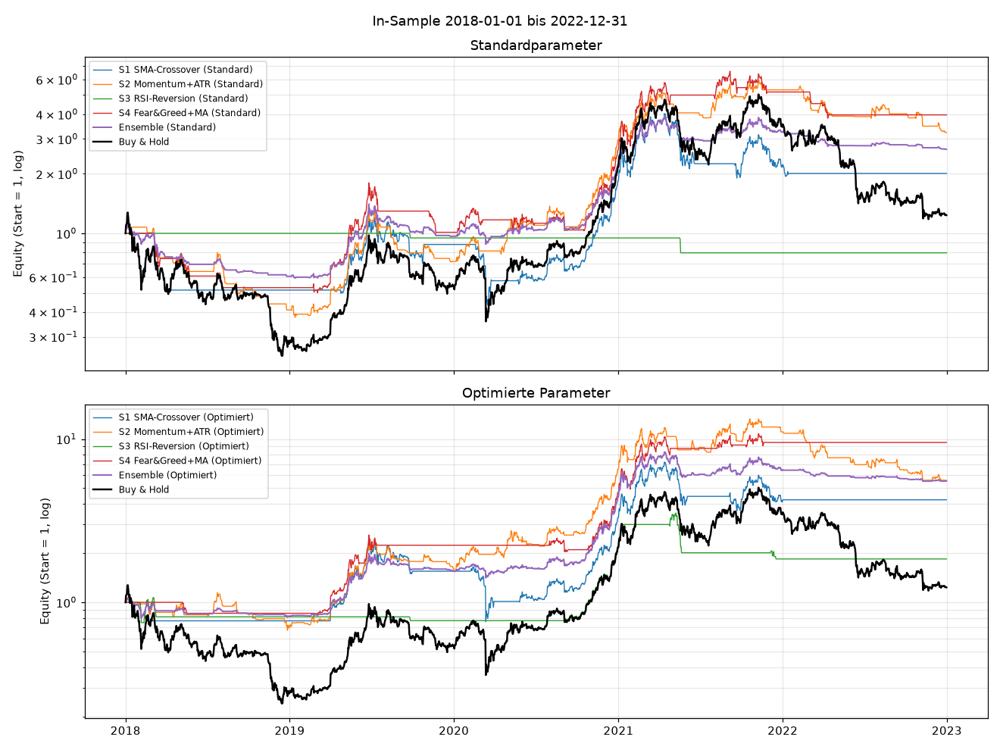
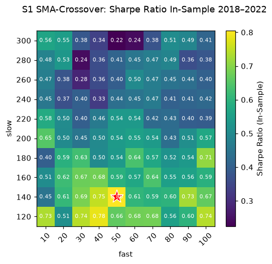
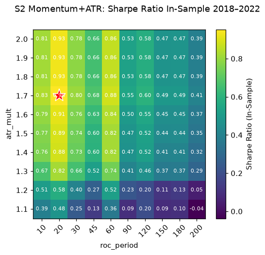
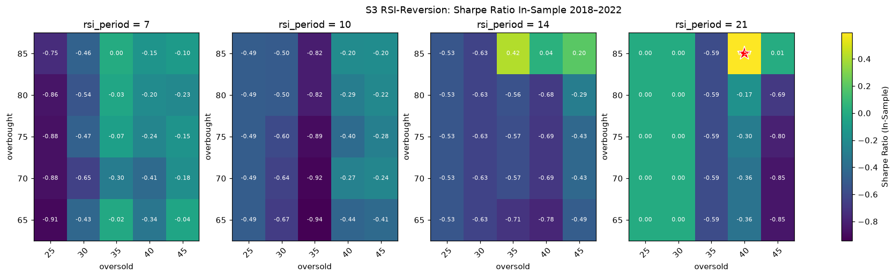
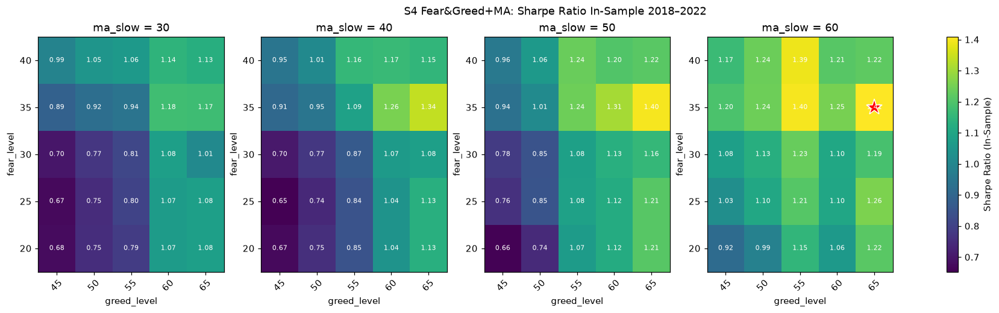

# Kommentierte Fotostrecke der Produkterstellung

Vorgabe Kreation: alle Phasen der Produkterstellung bildlich dokumentieren, jedes Bild mit Kommentar (was ist zu sehen, welcher Entscheid / welche Erkenntnis).
Neue Einträge über `/fotostrecke <Meilenstein>`. Dateinamen: `docs/fotostrecke/JJJJ-MM-TT_<inhalt>.png`.

---

## 2026-09-30 · Phase: Umsetzung, erstes KI-Ergebnis (Tag `v0.1-ki-unreviewed`)

Alle Bilder dieser Phase zeigen den **ungeprüften** KI-Code, nur In-Sample 2018–2022. Sie dienen später als Vergleich zum Stand nach dem Review.

### In-Sample-Equity aller Varianten

`docs/fotostrecke/2026-09-30_insample_equity.png` – Kapitalverlauf (log. Skala, Start = 1) aller Strategien, Ensembles und Buy & Hold, oben mit Standard-, unten mit optimierten Parametern.
Buy & Hold (schwarz) endet nach einem Drawdown von −81 % nur knapp über 1, fast alle Strategien liegen darüber, weil sie im Bärenmarkt 2018 und 2022 grösstenteils in Cash waren.
Erkenntnis: Die optimierten Kurven sehen deutlich besser aus, sind aber auf genau diesen Daten ausgesucht. Ob der Vorsprung hält, zeigt erst der Out-of-Sample-Test.

### S1 SMA-Crossover: Heatmap der Optimierung

`docs/fotostrecke/2026-09-30_s1_sma_crossover_heatmap.png` – Sharpe Ratio für 100 Kombinationen aus schnellem (10–100) und langsamem (120–300) Durchschnitt, Stern = beste Kombination.
Die Werte liegen zwischen 0.22 und 0.80, kürzere langsame Durchschnitte (120–180) sind tendenziell besser, aber gute und schwache Felder liegen direkt nebeneinander.
Erkenntnis: Die beste Kombination ist kein klares Plateau, ein Teil des Vorsprungs kann Zufall sein (Plateau-Check, E26).

### S2 Momentum+ATR: Heatmap der Optimierung

`docs/fotostrecke/2026-09-30_s2_momentum_atr_heatmap.png` – Sharpe Ratio für ROC-Periode × ATR-Multiplikator.
Kurze ROC-Perioden (10–60 Tage) mit ATR-Multiplikator ab 1.4 bilden ein breites, gleichmässig gutes Plateau, lange Perioden sind klar schlechter.
Erkenntnis: S2 ist gegenüber der Parameterwahl am stabilsten, das spricht für Robustheit statt Overfitting.

### S3 RSI-Reversion: Heatmap der Optimierung

`docs/fotostrecke/2026-09-30_s3_rsi_reversion_heatmap.png` – Sharpe Ratio für oversold × overbought, je ein Feld pro RSI-Periode (7, 10, 14, 21).
Fast alle Kombinationen sind negativ oder 0.00 (= nie eingestiegen), nur ein einzelnes Feld am Rand des Grids (RSI 21, oversold 40, overbought 85) ist positiv.
Erkenntnis: Das «Optimum» ist ein isolierter Ausreisser am Gridrand und wahrscheinlich Overfitting. Das Grid wird gemäss Vorgabe trotzdem nicht erweitert (offener Punkt im Prompt-Log).

### S4 Fear&Greed+MA: Heatmap der Optimierung

`docs/fotostrecke/2026-09-30_s4_feargreed_trend_heatmap.png` – Sharpe Ratio für greed_level × fear_level, je ein Feld pro ma_slow (30–60).
Die Werte steigen Richtung hoher greed- und fear-Schwellen und längerer MA, das beste Feld (Sharpe 1.40) liegt am Rand des Grids.
Erkenntnis: Der Trend ist deutlich, aber das Optimum könnte ausserhalb des getesteten Bereichs liegen. Hohe In-Sample-Sharpe bei nur 7 Trades ist mit Vorsicht zu lesen.
